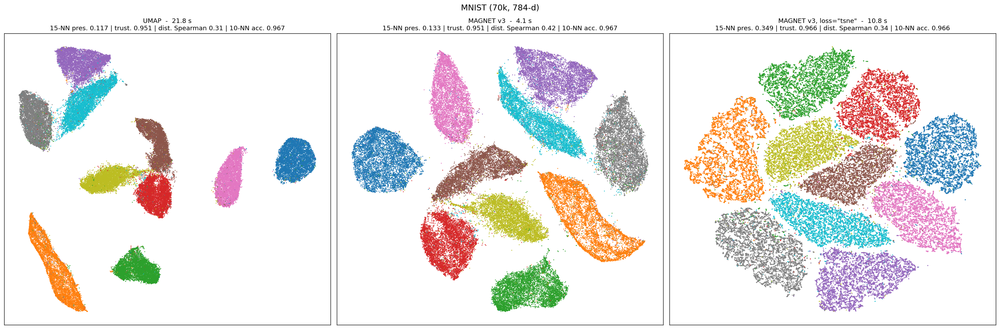
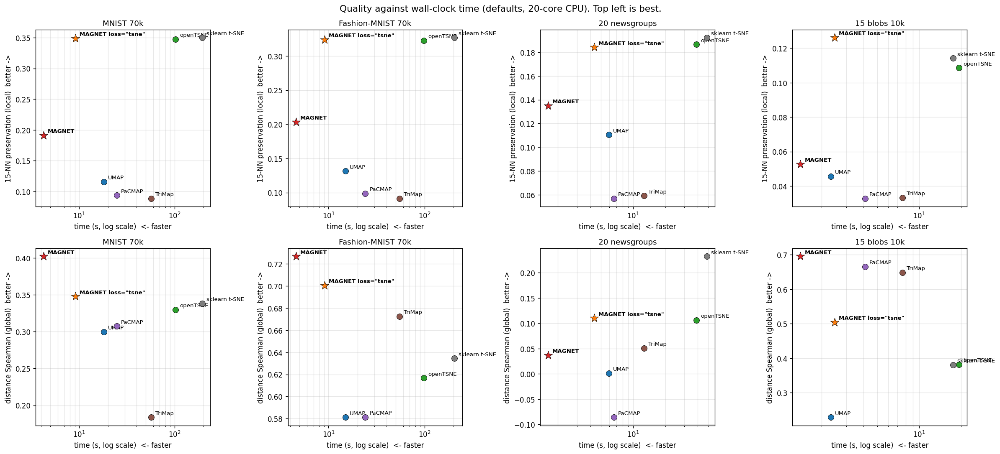
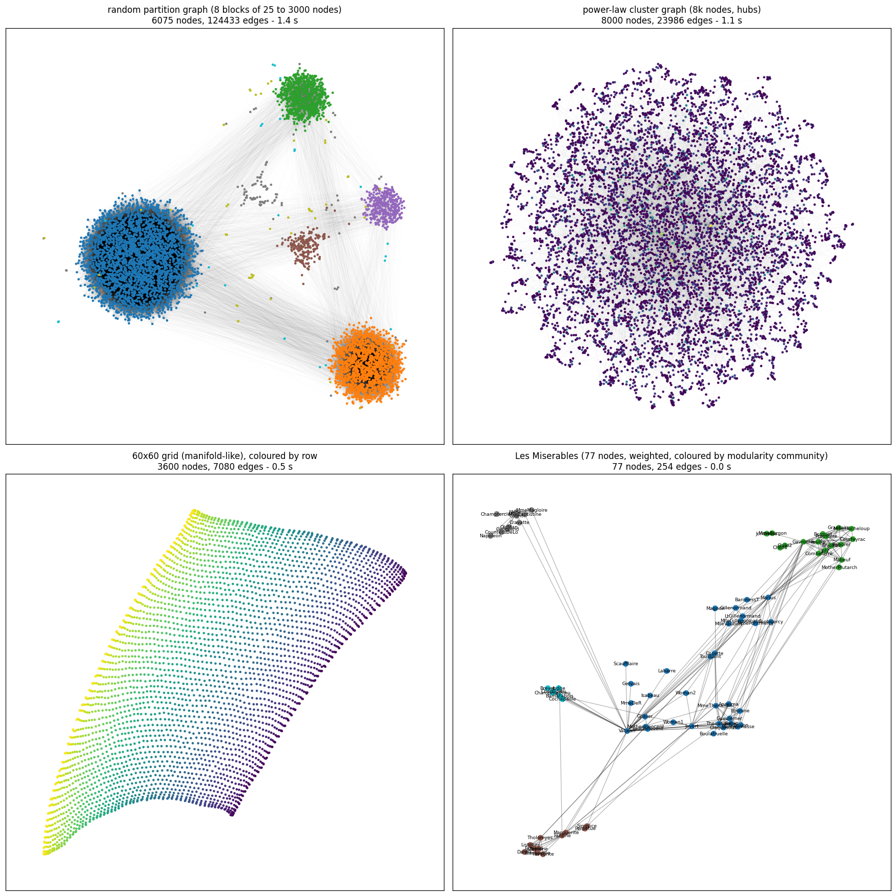

# MAGNET

**Fast dimensionality reduction and graph layout, built on attraction and repulsion.**

MAGNET turns a data matrix, a sparse matrix or a graph into a 2-D (or 3-D) layout the way UMAP
and t-SNE do: a neighbour graph pulls close points together, everything else pushes apart. It
rebuilds that pipeline from scratch in C++ and makes the one choice that matters explicit: how the
repulsion is estimated.

* `loss="umap"` (default): negative sampling, lock-free multithreaded SGD. **MNIST 70k in 4.2 s**
  against 18 s for UMAP, 15-NN preservation 0.19 against 0.12 and a distance correlation of 0.41
  against 0.30: the best global structure of the seven methods benchmarked.
* `loss="tsne"`: exact repulsion over all pairs through FFT interpolation. **MNIST 70k in 9 s**
  against 102 s for openTSNE and 196 s for scikit-learn's t-SNE, with the same neighbourhood
  preservation as those two, three times that of UMAP in less time.
* 1M points in 55 s and 3 GB. Native NN-descent (1.2 s for 70k x 784), spectral initialisation by
  Chebyshev-filtered subspace iteration, `transform()` for new points, sparse inputs, networkx graphs.





## Install

```bash
pip install .            # C++17 compiler needed; numpy, scipy, tqdm; hnswlib optional
python -m pytest tests -q
```

## Quickstart

```python
from magnet import MAGNET

Y = MAGNET().fit_transform(X)                        # X: (n, d) array; row i of Y is X[i]
Y = MAGNET(loss="tsne").fit_transform(X)             # exact repulsion, t-SNE-grade local structure
Y = MAGNET(metric="cosine").fit_transform(T)         # sparse CSR matrix (TF-IDF), no densification
Y = MAGNET().fit_transform(G)                        # networkx graph, rows follow list(G.nodes)
Y = MAGNET().fit_transform(A)                        # scipy sparse adjacency (weights = similarities)

m = MAGNET().fit(X)
Y_new = m.transform(X_new)                           # out-of-sample points, training layout fixed
m.embedding_, m.graph_, m.knn_indices_, m.knn_dists_
```

## Two regimes, one knob

t-SNE, UMAP and LargeVis optimise the same kind of objective and differ mostly in the balance
between attraction and repulsion (Boehm, Berens & Kobak 2022); the negative-sampling estimator of
UMAP is biased towards weak repulsion, which is what makes its clusters compact (Damrich &
Hamprecht 2021). MAGNET exposes this directly:

| | repulsion | look | when |
|---|---|---|---|
| `loss="umap"` | sampled (5 random points per positive sample) | UMAP-like, with the global structure of PaCMAP | speed, 3-D, graphs, millions of points |
| `loss="tsne"` | exact, all pairs, FFT-accelerated (2-D) | t-SNE-like, finest local structure | best neighbourhood preservation |
| `loss="tsne", exaggeration=4` | exact | UMAP-like again | the two regimes really are one spectrum |

`repulsion_strength` (default 2) and `exaggeration` move along the spectrum within each mode.

The tail of the low-dimensional kernel is the other lever. UMAP fits `1 / (1 + a d^2b)` to a
`min_dist` curve and lands near b = 0.8; a heavier tail preserves neighbourhoods far better at equal
global structure and label accuracy (MNIST 70k, 15-NN preservation): b = 0.8: 0.13, b = 0.7: 0.16,
b = 0.6: 0.19, **b = 0.5: 0.21**, b = 0.4: 0.19. Text data peaks at 0.6-0.7, images at 0.5, so the
default is `kernel_b=0.6`. The exponent cannot be learned by gradient on the same loss (it sharpens
the kernel into a step and trades off against the global scale); it is a per-dataset choice, and the
benchmark harness is the way to make it. In 3-D the crowding is milder and the optimum moves back to
b = 0.8 (MNIST 20k, `n_components=3`: 15-NN 0.327 at 0.8 against 0.326 at 0.6 and 0.316 at 0.5, with
better trustworthiness and global structure), hence the dimension-dependent default. `n_neighbors`
stays at 15: 10 gains 4% of 15-NN preservation and loses a little global structure, 30 the opposite.
Graph inputs are unaffected by the new kernel (SBM: label accuracy 1.00 either way), `transform()`
keeps 0.958 of 10-NN accuracy on MNIST test points, and the 1M synthetic point runs in 54 s.
(`kernel_b="auto"` sweeps 0.4-0.7 on a 4k subsample by
15-NN preservation in a few seconds, but the optimum depends on the sample size: it picked 0.7 on a
MNIST subsample where the full 20k wants 0.5. The flat region 0.5-0.7 makes the fixed default the
safer choice.) What does *not* predict it: the intrinsic dimension of the data. On Gaussian
manifolds of dimension 4 to 32 the optimum saturates at b = 0.4, on MNIST / Fashion-MNIST / 20
newsgroups it moves the other way (0.5 / 0.6 / 0.7 for TwoNN dimensions 14 / 16 / 20), and the only
case that wants the Cauchy kernel (b = 1) is a genuinely 2-dimensional manifold, where there is no
crowding to compensate. Kernels with exponential or lighter tails confirm the crowding theory the hard
way: on MNIST 20k, 15-NN preservation 0.285 (power, b 0.6) against 0.16 (sech), 0.11 (Gaussian) and
0.10 (1 - tanh(d^2)). Reshaping the neighbour-distance profile on the input side (a power transform or
a rank-dependent factor, `neighbor_power` / `neighbor_rank_exponent`) changes nothing: the smooth-kNN
calibration absorbs monotone transforms of the distances. A per-point exponent driven by the local
intrinsic dimension (`kernel_b="local"`, dimprint estimates: median 17.6 on MNIST, 10 to 34 across
points) does not beat the best constant either: heavier tails where the local dimension is higher
buy 0.01-0.03 of distance correlation for 0.5-1.5 points of 15-NN preservation, and the inverse law
is worse on both, so the direction is right but the effect is small. The exact-repulsion mode behaves the other way round: a
heavier Student-t tail (`tsne_dof` < 1) raises trustworthiness and compactness but lowers 15-NN
preservation (0.405 at dof 1, 0.354 at dof 0.5 on MNIST 20k), as Kobak et al. found; its default
stays the Cauchy kernel.
Cluster compactness is a look, not a fidelity measure (it can always be bought with neighbourhood
quality); if you want UMAP's tight blobs, `late_exaggeration=1.5` gives a silhouette of 0.61 on MNIST
against 0.52 for UMAP while staying ahead of it on every other metric (15-NN 0.170 against 0.116).

### The written UMAP loss, optimised exactly (`loss="umap_exact"`)

A research mode: the cross-entropy UMAP writes down, with its repulsion summed over all pairs by the
same FFT machinery, scaled by `repulsion_strength`. On MNIST 20k the loss as written (weight 1)
destroys the layout (15-NN preservation 0.002, label accuracy 0.25); the sampled optimiser's quality
is only approached once the repulsion is divided by about 1000 (weight 0.001: 0.263 against 0.286),
which is the order of n / (negative_sample_rate x samples per node) = 20000 / 25 predicted by
Damrich & Hamprecht for the implicit down-weighting of negative sampling. Two conclusions: UMAP's
embeddings come from that bias, not from its stated objective, and removing the sampling noise
without changing the balance (the "debiased UMAP") brings nothing: in the exact setting the
normalised repulsion of t-SNE (`loss="tsne"`, 0.405) is the one that works.

## How it works

```
data (n, d) ──NN-descent──▶ kNN ──smooth kNN──▶ fuzzy graph ─┐
   or CSR     (C++, SIMD)                                    ├─▶ init ──▶ optimiser ──▶ layout
networkx graph / sparse adjacency ───────────────────────────┘
```

1. **Neighbours.** NN-descent with a random-projection forest for the initial candidates, lock-free
   multithreaded local joins (each heap is only written by its owner thread), AVX-512 / AVX2 distance
   kernels picked at runtime, dense or CSR rows. Recall 0.995 on MNIST at k = 15.
2. **Graph.** UMAP's smooth-kNN kernel and fuzzy union, vectorised. Graph inputs are symmetrised and
   degree-normalised so that hubs do not monopolise the sampling budget.
3. **Initialisation.** Leading non-trivial eigenvectors of the normalised adjacency, by a
   Chebyshev-filtered subspace iteration in C++ (0.2 s for 20k points; ARPACK needs seconds and
   sometimes fails to converge). Disconnected components are laid out separately and placed according
   to their centroids. PCA is used instead for `loss="tsne"` on data (better global structure).
4. **Mid-range pairs.** For every point, the second closest of six random points measured in the
   data (PaCMAP's mid-near pairs, 0.2 s for 70k x 784 in C++): a weak spring towards them, annealed
   to zero over the first half of the optimisation, tells the layout where the clusters go relative
   to each other. For graphs, short random walks play that role.
5. **Optimiser.** Either Hogwild SGD with an explicit sampling budget per node (`samples_per_node`,
   so the cost of an epoch does not depend on the graph) and negatives; or full-batch gradient
   descent with the t-SNE objective,
   early exaggeration, gains and momentum, where the repulsive field is the convolution of the point
   density with a radial kernel, evaluated by Lagrange interpolation on a grid and FFT.

## Benchmarks

Measured on a 20-core i9-9900X, several seeds, defaults everywhere. Local structure: 15-NN
preservation and trustworthiness. Global structure: Spearman correlation of pairwise distances and
random-triplet accuracy on a sample. Label structure: 10-NN accuracy in 2-D. The full table against
UMAP, openTSNE, PaCMAP, TriMap and scikit-learn's t-SNE is in [benchmarks/BENCHMARK.md](benchmarks/BENCHMARK.md).

**MNIST 70k**

| | time | 15-NN pres. | trustworthiness | dist. Spearman | triplet acc. | 10-NN acc. |
|---|---|---|---|---|---|---|
| **MAGNET** | **4.2 s** | 0.191 | 0.957 | **0.402** | **0.640** | 0.966 |
| MAGNET, `kernel_b=0.5` | 4.1 s | 0.206 | 0.959 | 0.406 | 0.641 | 0.967 |
| MAGNET, `late_exaggeration=1.5` (compact preset, silhouette 0.61 against 0.52 for UMAP) | 4.2 s | 0.170 | 0.955 | 0.371 | 0.632 | 0.967 |
| **MAGNET `loss="tsne"`** | 9.2 s | 0.349 | 0.966 | 0.348 | 0.627 | 0.966 |
| UMAP 0.5.11 | 18.2 s | 0.116 | 0.951 | 0.300 | 0.607 | 0.967 |
| openTSNE 1.0.4 | 102.5 s | 0.347 | **0.968** | 0.330 | 0.619 | 0.965 |
| PaCMAP | 24.8 s | 0.093 | 0.946 | 0.307 | 0.614 | **0.976** |
| TriMap | 57.0 s | 0.088 | 0.933 | 0.184 | 0.597 | 0.964 |
| sklearn t-SNE (Barnes-Hut) | 195.7 s | **0.350** | **0.968** | 0.338 | 0.622 | 0.967 |

**Other data sets** (MAGNET default / best competitor on that column)

| dataset | time | 15-NN pres. | trust. | dist. Spearman |
|---|---|---|---|---|
| Fashion-MNIST 70k | **4.6 s** / 15.0 s UMAP | 0.203 / 0.327 sklearn t-SNE | 0.980 / 0.983 openTSNE | **0.727** / 0.672 TriMap |
| 20 newsgroups SVD-300, cosine | **1.6 s** / 5.9 s UMAP | 0.135 / 0.192 sklearn t-SNE | 0.765 / 0.772 openTSNE | 0.037 / 0.232 sklearn t-SNE |
| 20 newsgroups TF-IDF, sparse 18.8k x 24k | **5.7 s** / 22.2 s UMAP | 0.145 / 0.140 UMAP | 0.730 / 0.716 UMAP | 0.144 / 0.145 UMAP |
| 15 Gaussian blobs 10k x 200 | **1.4 s** / 2.3 s UMAP | 0.053 / 0.114 sklearn t-SNE | 0.971 / 0.975 sklearn t-SNE | **0.695** / 0.666 PaCMAP |
| SBM graph, 30k nodes, 782k edges | **4.9 s** / 36 s UMAP | | | 10-NN acc. 1.00 / 0.26 |

**Scaling** (50 anisotropic clusters in 50 dimensions)

| n | MAGNET | UMAP | peak RSS |
|---|---|---|---|
| 100k | 7 s | 37 s | 0.4 / 2.1 GB |
| 250k | 16 s | 55 s | 0.8 / 3.0 GB |
| 500k | 30 s | 85 s | 1.6 / 5.1 GB |
| 1M | 55 s | | 3.1 GB |

`loss="tsne"` on the same data: 17 s at 250k and 56 s at 1M points (600 iterations; at 1M the
attraction pass over the 40M edges and the position update dominate, the FFT repulsion step costs
0.1 s). The scatter, spectral products and gather of that step run in C++; the transforms use
scipy's pocketfft, which was never the bottleneck.

`transform()` on MNIST (fit 60k, transform 10k): 0.6 s and 10-NN accuracy 0.962 against 14.8 s and
0.956 for UMAP.

Regenerate everything with `benchmarks/full_table.py`, `benchmarks/render_table.py`, `benchmarks/plot_tradeoff.py`,
`benchmarks/compare_plots.py`, `benchmarks/scaling.py` and `benchmarks/graph_demo.py`.

## Graphs

Any networkx graph or sparse adjacency matrix is laid out directly, in linear time: communities of
25 to 3000 nodes in 1.4 s, an 8k-node power-law graph in 1.1 s, a 60 x 60 grid comes out as a sheet.



## Parameters

| parameter | default | meaning |
|---|---|---|
| `n_components` | 2 | output dimension (`loss="tsne"` is 2-D only) |
| `n_neighbors` | 15 | neighbourhood size (counts the point itself, as in UMAP) |
| `metric` | `"euclidean"` | or `"cosine"` |
| `min_dist`, `spread` | 0.05, 1.0 | shape of the low-dimensional kernel (UMAP semantics; 0.05 beats UMAP's 0.1 on every metric here) |
| `late_exaggeration`, `late_phase` | 1.0, 0.2 | attraction multiplier over the last epochs; `1.5` is the "compact clusters" preset |
| `loss` | `"umap"` | `"umap"` (sampled repulsion), `"tsne"` (exact), `"infonce"` (contrastive softmax) |
| `exaggeration`, `repulsion_strength` | 1, 2 | attraction / repulsion multipliers |
| `n_epochs` | auto | SGD epochs (500 / 300 / 200 by size) or t-SNE iterations (450); also `(constant, anneal)` or `"auto"` |
| `samples_per_node` | 5 | attractive samples per node and per epoch |
| `negative_sample_rate` | 5 | negatives per positive sample |
| `mid_source`, `n_mid_pairs`, `mid_jump` | `"auto"`, 5, 0.5 | mid-range partners from the data (PaCMAP-style pairs), from random walks on the graph, or `"hybrid"` walks on both layers |
| `walk_len`, `mid_weight`, `mid_rate`, `mid_phase` | 4, 0.1, 0.25, 0.5 | strength and schedule of the mid-range attraction (`mid_weight=0` disables) |
| `init` | `"auto"` | PCA for `loss="tsne"` on data, spectral otherwise; or `"spectral"`, `"pca"`, `"random"`, an array |
| `knn` | `"nndescent"` | or `"hnsw"` (needs hnswlib) |
| `pca` | None | project wide data to this many components before the neighbour search |
| `kernel_b` | `"auto_dim"` | tail exponent of the kernel: 0.6 in 2-D (0.5 for images, 0.7 for text), 0.8 in 3-D; None = UMAP's fit; 1 = Cauchy |
| `kernel` | `"power"` | or `"gaussian"`, `"sech"` (exponential tails, for comparison) |
| `tsne_dof` | 1.0 | Student-t degrees of freedom of `loss="tsne"` (< 1 = heavier tail, Kobak et al. 2019) |
| `fft_interp`, `fft_box` | 3, 1.0 | grid of the exact repulsion (`fft_box=1.5` is the fast preset) |
| `mid_scale` | `"fixed"` | or `"spread"` / `"rolewalk"`: per-node length of the mid-range walks from the graph's diffusion spread or from RoleWalk roles |
| `component_placement` | `"centroid"` | or `"rolewalk"`: disconnected components of a graph placed by their structural-role signature |
| `optimizer`, `clip` | `"sgd"`, `"coord"` | or `"adam"`; `"norm"` clips the step norm |
| `input` | `"auto"` | a sparse square matrix is an adjacency; `"data"` or `"graph"` to force |
| `graph_norm` | `"sym"` | degree normalisation of graph inputs |
| `transform_epochs` | 50 | epochs of `transform()` |
| `n_threads`, `random_state`, `verbose` | -1, None, False | |

Runs are reproducible only with `n_threads=1`: the SGD is lock-free.

## What was tried and did not make the cut

Measured with the harness, kept as options: constant-then-anneal and automatic epoch schedules
(lose local structure against a plain linear decay), per-node Adam, norm clipping, InfoNCE
(more global, less local), a bit-level `pow` approximation (no gain), the Cauchy kernel as default.
Random walks on a two-layer graph (kNN edges plus mid-near edges, `mid_source="hybrid"`): one
mechanism for every scale on paper, but each walk step after a mid-range jump diffuses back into
local structure and dilutes the inter-cluster signal (distance correlation 0.39 against 0.42 on
MNIST, 0.68 against 0.71 on Fashion-MNIST, local unchanged). A per-node diffusion scale for the
mid-range walks (`mid_scale="spread"` or `"rolewalk"`) changes nothing measurable on MNIST: the mid-range term itself matters (distance correlation 0.35 against
0.29 without it) but not its per-node length. For graph inputs, mid-near pairs measured in an 8-d
spectral embedding (`mid_source="spectral"`) lose to the random walks (0.31 against 0.34 on the kNN
graph of MNIST evaluated against the hidden data): walks stay the default for graphs. What did make the cut: `repulsion_strength=2` (+8%
neighbourhood preservation, nothing lost), the centroid placement of disconnected components, PCA
initialisation for the exact-repulsion mode, PaCMAP-style mid-near pairs in place of random walks for
data inputs (distance correlation +30% on MNIST, +25% on Fashion-MNIST, for 3% of 15-NN preservation),
and for graphs the placement of disconnected components by RoleWalk signature
(`component_placement="rolewalk"`: structurally similar components end up next to each other).

## History

MAGNET started in 2019 as a random-walk embedding with a full-batch optimiser; v3 (2026) is a
complete rewrite around per-edge SGD, a native neighbour search and the exact-repulsion mode.
RoleWalk, the author's structural-role embedding, is the natural companion for graph inputs.

## Cite

```
@software{magnet,
  author = {Chenebaux, Maixent},
  title  = {MAGNET: fast dimensionality reduction and graph layout},
  year   = {2026},
  url    = {https://github.com/kerighan/lib-magnet}
}
```
