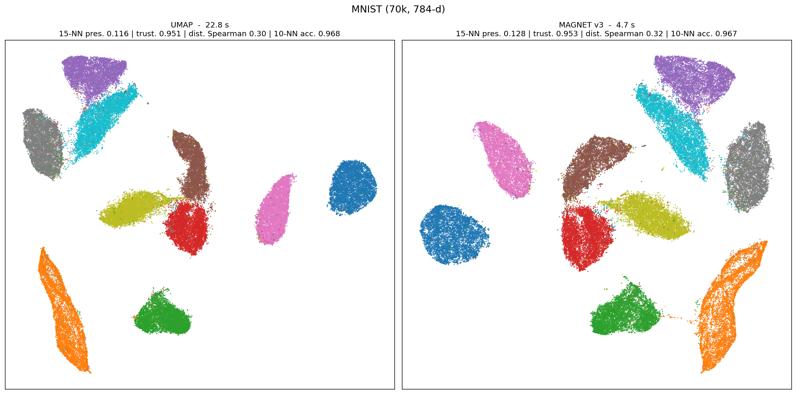
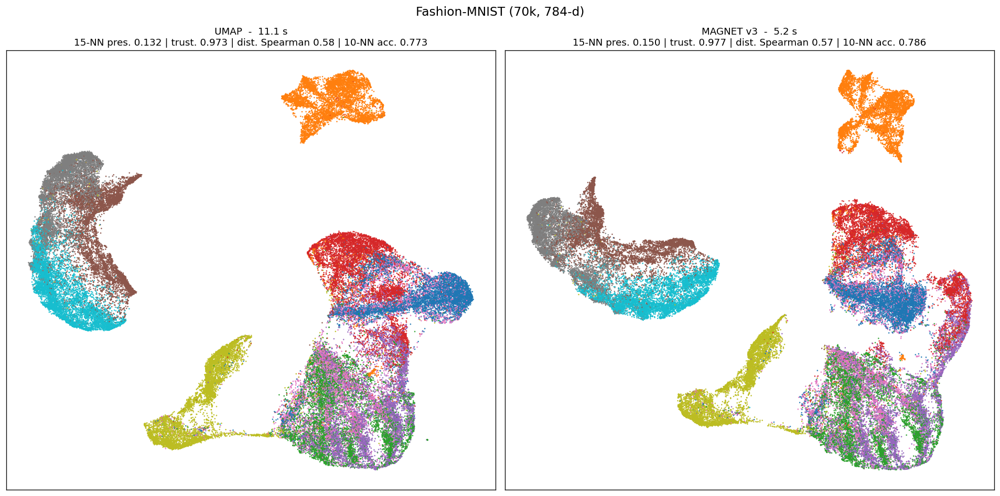

# MAGNET v3

Fast graph-based dimensionality reduction, in the spirit of UMAP / LargeVis, for data matrices
**and** graphs.

```
data (n, d) ──NN-descent──▶ kNN ──smooth kNN──▶ fuzzy graph ─┐
              (C++, SIMD)                                    ├─▶ spectral init ──▶ Hogwild SGD ──▶ embedding
networkx graph / scipy sparse adjacency ─────────────────────┘   (Chebyshev)       (C++ threads)
```

* **kNN**: native NN-descent (random-projection forest initialisation, lock-free multithreaded local
  joins, AVX-512/AVX2 distance kernels chosen at runtime): 1.2 s for MNIST 70k x 784 at recall 0.995,
  where hnswlib needs 4.5 s. `knn="hnsw"` keeps hnswlib as an alternative; `pca=` projects wide data
  first.
* **Graph weights**: UMAP's smooth-kNN kernel and fuzzy union, vectorised in numpy; graph inputs are
  symmetrised and degree-normalised.
* **Initialisation**: leading non-trivial eigenvectors of the normalised adjacency, computed by a
  Chebyshev-filtered subspace iteration written in C++ (0.2 s for 20k points, converges to the exact
  eigenvectors where ARPACK needs seconds). Disconnected components are laid out separately and placed
  according to their centroids in data space.
* **Optimisation**: lock-free multithreaded SGD with negative sampling, an explicit sampling budget
  (`samples_per_node`, so the cost of an epoch does not depend on the input graph) and an optional
  *mid-range attraction*: random walks on the graph provide multi-hop positive pairs, annealed during the
  first epochs, which pull the layout towards the diffusion geometry of the graph.

## Install

```bash
pip install -e .            # needs a C++17 compiler, pybind11, numpy, scipy, tqdm (hnswlib optional)
MAGNET_NATIVE=1 pip install -e .   # optional: -march=native
python -m pytest tests -q
```

## Usage

```python
from magnet import MAGNET

Y = MAGNET().fit_transform(X)                       # X: (n, d) array, row i of Y is X[i]
Y = MAGNET(metric="cosine", pca=50).fit_transform(X) # faster kNN on wide data
Y = MAGNET(n_components=3, min_dist=0.3).fit_transform(X)

Y = MAGNET().fit_transform(G)                       # networkx graph: rows follow list(G.nodes)
Y = MAGNET().fit_transform(A)                       # scipy sparse adjacency (weights = similarities)
Y = MAGNET(metric="cosine").fit_transform(T)        # sparse CSR data matrix (TF-IDF), no densification

m = MAGNET(verbose=True).fit(X)
m.embedding_, m.graph_, m.knn_indices_, m.knn_dists_
Y_new = m.transform(X_new)                          # out-of-sample points, training layout kept fixed
```

A sparse square matrix is read as an adjacency matrix; pass `input="data"` to treat it as data.

Main parameters (all have sensible defaults):

| parameter | default | meaning |
|---|---|---|
| `n_neighbors` | 15 | neighbourhood size (counts the point itself, as in UMAP) |
| `min_dist`, `spread` | 0.1, 1.0 | shape of the low-dimensional kernel (UMAP semantics) |
| `n_epochs` | 500 / 300 / 200 | by size (<= 10k / <= 100k / larger); linear learning-rate decay. Also `(constant, anneal)` or `"auto"` |
| `loss` | `"umap"` | or `"infonce"` (contrastive softmax over the positive and its negatives: more global, less compact) |
| `exaggeration`, `repulsion_strength` | 1, 2 | multipliers on the attractive / repulsive gradients |
| `kernel_b` | None | fix the kernel exponent; `kernel_b=1` (Cauchy) removes the pow() and makes the SGD ~30% faster at a cost of ~10% on 15-NN preservation |
| `optimizer`, `clip` | `"sgd"`, `"coord"` | or `"adam"`; `"norm"` clips the step norm instead of each coordinate |
| `transform_epochs` | 50 | epochs used by `transform()` |
| `samples_per_node` | 5 | attractive samples per node and per epoch |
| `negative_sample_rate` | 5 | negatives per positive sample |
| `mid_weight`, `walk_len`, `mid_rate`, `mid_phase` | 0.1, 4, 0.25, 0.5 | mid-range attraction through random walks (`mid_weight=0` disables it) |
| `init` | `"auto"` | PCA for `loss="tsne"` on data, spectral otherwise; or `"spectral"`, `"pca"`, `"random"`, an array |
| `knn` | `"nndescent"` | or `"hnsw"` (needs hnswlib) |
| `pca` | None | project to this many PCA components before the kNN search |
| `graph_norm` | `"sym"` | degree normalisation of graph inputs |
| `n_threads` | -1 | all cores |

## Benchmarks

`benchmarks/` contains a small harness (`bench.py`, `compare.py` for multi-seed runs, `sweep.py`) with
local metrics (15-NN preservation, trustworthiness, 10-NN classification accuracy of the labels) and
global metrics (Spearman correlation of pairwise distances and random-triplet accuracy on a sample).
Numbers below are measured on a 20-core i9-9900X, UMAP 0.5.11 with default parameters, 3 seeds.


| dataset | method | time (s) | 15-NN pres. | trustworthiness | dist. Spearman | triplet acc. | 10-NN acc. |
|---|---|---|---|---|---|---|---|
| MNIST 70k (784-d) | UMAP | 16.2 ± 5.5 | 0.118 | 0.951 | 0.301 | 0.609 | 0.967 |
| | **MAGNET v3** | **5.6 ± 0.1** | **0.128** | **0.953** | **0.321** | **0.614** | 0.967 |
| MNIST 20k | UMAP | 8.9 ± 5.9 | 0.212 | 0.954 | 0.303 | 0.609 | 0.957 |
| | **MAGNET v3** | **1.6 ± 0.1** | **0.227** | 0.955 | **0.340** | **0.621** | 0.956 |
| 20 newsgroups TF-IDF (18.8k x 24k sparse, cosine) | UMAP | 22.2 ± 7.5 | 0.140 | 0.716 | 0.145 | 0.377 | 0.601 |
| | **MAGNET v3** | **5.7 ± 0.1** | 0.145 | **0.730** | 0.144 | 0.378 | **0.613** |
| 20 newsgroups SVD-300 (cosine) | UMAP | 7.5 ± 5.9 | 0.109 | 0.736 | 0.001 | 0.518 | 0.505 |
| | **MAGNET v3** | **3.8 ± 0.2** | 0.109 | **0.756** | -0.014 | 0.515 | 0.512 |
| 15 Gaussian blobs (10k, 200-d) | UMAP | 9.2 ± 6.4 | 0.046 | 0.971 | 0.133 | 0.544 | |
| | **MAGNET v3** | **1.3 ± 0.0** | 0.049 | 0.971 | **0.552** | **0.696** | |
| SBM graph (30k nodes, 782k edges, 6 blocks) | UMAP (precomputed sparse) | 36.2 | | | | | 0.264 |
| | **MAGNET v3** | **4.9** | | | | | 1.000 |

Reading: with the default `repulsion_strength=2`, local structure (15-NN preservation,
trustworthiness) is better than UMAP on every dataset at equal label accuracy; global structure
(distance correlation, triplet accuracy) is equal or better, markedly so when the kNN graph has several
connected components (blobs), thanks to the centroid-based placement of components. Wall-clock time
is 3 to 8 times lower. UMAP timings fluctuate between runs (numba); MAGNET timings are stable.

Where the time goes on MNIST 70k (20 cores): NN-descent kNN ~1.2 s, fuzzy graph ~0.5 s, spectral
init ~0.5 s, 300 SGD epochs ~3 s.

`transform()` on MNIST (fit on 60k, transform 10k): 0.6 s and 10-NN accuracy 0.962 of the new points
against the training labels, versus 14.8 s and 0.956 for UMAP's `transform`.

### Scaling (synthetic data, 50 anisotropic clusters in 50 dimensions, `benchmarks/scaling.py`)

| n | MAGNET v3 | UMAP | peak RSS MAGNET / UMAP |
|---|---|---|---|
| 100k | 7.0 s | 37 s | 0.4 / 2.1 GB |
| 250k | 15.9 s | 55 s | 0.8 / 3.0 GB |
| 500k | 32 s | 85 s | 1.6 / 5.1 GB |
| 1M | 55 s | not run | 3.1 GB |

Both scale linearly; the distance correlation of MAGNET's layouts is 0.32-0.40 against 0.05-0.16 for
UMAP on these data (component placement by centroids). At 1M points the first profile was: kNN +
graph 10 s, spectral init 24 s, edge schedule 6 s, SGD 31 s. The spectral solver now floors the
eigengap (a degenerate spectrum, as with many clusters, no longer runs to the iteration cap) and the
edge-sampling budget is solved exactly in O(n log n) instead of by bisection. After these two changes
the 1M run takes 55 s (kNN + graph 9.5 s, spectral init 10 s, edge schedule 3 s, SGD 32 s for
200 epochs with dimension-specialised kernels; `n_epochs=100` halves the last term at a cost of about 2% on 15-NN preservation).

### Graphs

Any `networkx` graph or scipy sparse adjacency matrix is laid out directly (`benchmarks/graph_demo.py`):
communities of 25 to 3000 nodes in 1.4 s, a 60x60 grid comes out as a sheet, an 8k-node power-law
graph in 1.1 s, where `nx.spring_layout` is quadratic per iteration.


### Exact repulsion: `loss="tsne"`

Negative sampling estimates the repulsion from a handful of random points per positive sample; the
estimator is biased and that bias is what gives UMAP its compact clusters (Damrich & Hamprecht 2021).
`loss="tsne"` computes the repulsion over **all** pairs at every iteration: the forces are a
convolution of the point density with a radial kernel, evaluated by Lagrange interpolation on unit
boxes and FFT (the FIt-SNE construction, 3 nodes per box, kernel spectra cached), with the t-SNE
objective, early exaggeration, gains and momentum as in openTSNE. The kNN graph, the spectral
initialisation and the C++ scatter / gather / attraction kernels are shared with the rest of MAGNET.
`exaggeration` is then the attraction multiplier of the final phase: 1 is t-SNE, about 4 reproduces
the UMAP look (Boehm, Berens & Kobak 2022). 2-D only.

Defaults: 450 iterations (150 of early exaggeration, enough from a spectral initialisation where
openTSNE's 250 + 500 are tuned for PCA or random starts), boxes of width 1.5 with 3 interpolation
nodes (node spacing 0.5: the repulsion error is about 1%, without measurable effect on the layout).

MNIST 20k, 2 seeds:

| | time | 15-NN pres. | trustworthiness | dist. Spearman | 10-NN acc. | silhouette |
|---|---|---|---|---|---|---|
| MAGNET SGD (default) | 1.6 s | 0.227 | 0.955 | 0.340 | 0.956 | 0.457 |
| MAGNET `loss="tsne"` | **3.9 s** | **0.395** | **0.970** | 0.339 | 0.957 | 0.333 |
| MAGNET `loss="tsne"`, FIt-SNE settings (750 it., box 1.0) | 10.6 s | 0.408 | 0.970 | 0.333 | 0.956 | 0.336 |
| MAGNET `loss="tsne", exaggeration=4` | 5.9 s | 0.212 | 0.955 | 0.342 | 0.958 | 0.516 |
| UMAP | 8.9 s | 0.212 | 0.954 | 0.303 | 0.957 | 0.478 |

MNIST 70k, against openTSNE 1.0.4 (same objective, FFT interpolation in C, `n_jobs=-1`):

| | time | 15-NN pres. | trustworthiness | dist. Spearman | 10-NN acc. |
|---|---|---|---|---|---|
| MAGNET `loss="tsne"` (defaults, PCA init) | **7.6 s** | 0.324 | 0.967 | 0.340 | 0.968 |
| MAGNET `loss="tsne"`, spectral init | 7.8 s | 0.324 | 0.965 | 0.304 | 0.965 |
| MAGNET `loss="tsne"`, FIt-SNE settings | 18.4 s | 0.359 | 0.965 | 0.295 | 0.966 |
| openTSNE | 101.8 s | 0.348 | 0.968 | 0.331 | 0.965 |
| UMAP | 16.2 s | 0.118 | 0.951 | 0.301 | 0.967 |

The initialisation matters for the global structure of this mode: PCA (openTSNE's choice) gives
distance correlations of 0.340 / 0.356 / 0.622 on MNIST 70k / MNIST 20k / Fashion-MNIST against
0.304 / 0.338 / 0.605 from the spectral start, at identical local metrics and time, hence the default.

Per iteration at 70k the FFT repulsion costs about 10 ms, the attraction 3 ms and the fused
gains / momentum update under 1 ms; the kNN graph (1.2 s) and the spectral initialisation (0.4 s)
account for most of the gap with openTSNE's ~40 s of neighbour search and affinities.

### Things that were tried and did not beat the defaults (benchmarks/cache/variants*.log)

* Constant learning rate followed by annealing, and an automatic stop when the layout stops moving:
  both lose local structure against a plain linear decay with the same number of epochs (the long
  annealing tail does useful work). Kept as options (`n_epochs=(constant, anneal)` or `"auto"`).
* Per-node Adam: slightly better 15-NN preservation, worse everywhere else and slower.
* Norm clipping: indistinguishable from coordinate clipping.
* InfoNCE loss: distance correlation 0.36 against 0.32 on MNIST 70k, but trustworthiness 0.935
  against 0.951 and 10-NN accuracy 0.950 against 0.968. A genuine local/global knob, not a free win.

What did win: the attraction/repulsion balance. UMAP's defaults are on the attractive side (Böhm,
Berens & Kobak 2022). On MNIST 70k, `repulsion_strength=2` raises 15-NN preservation from 0.119 to
0.128 and trustworthiness from 0.951 to 0.953 with unchanged label accuracy, cluster compactness and
run time, so it is the default. `exaggeration=0.5` or `negative_sample_rate=10` go further on the
local metrics but loosen the clusters or cost time.




Side-by-side pictures: `python benchmarks/compare_plots.py` writes `benchmarks/plots/compare_*.png`.

## What changed from v2

v2 sampled consecutive pairs of random walks, corrupted them for negatives and ran a full-batch
RMSProp. Bugs found and fixed on the way to v3:

* the embedding rows were **permuted** with respect to the input points when a data matrix was given
  (networkx node insertion order was used as the row order);
* hnswlib returns **squared** L2 distances, which were squared again in the local scaling kernel;
* `weightedCorruptWalks` wrote one element past the end of the similarity matrix (`y == walkLen-1`)
  and silently mislabelled the first pair of the next walk;
* `trainOnBatch` computed the per-thread gradient slot from the chunk start, so two threads could share
  the same buffer (data race, wrong gradients) and the remainder chunk raced with the last thread;
* `setup.py` passed `extra_compile` instead of `extra_compile_args`, so `-Ofast` was never applied;
* `spectral_init` was called with an undefined matrix when `init_iter == 0`;
* the global xorshift state was shared between threads (undefined behaviour, correlated draws);
* the C++ `randomWalks` wrote into a `reserve`d vector and fell back to the first neighbour of node 0
  when the cumulative probabilities did not reach the draw.

v3 keeps the ideas (kNN graph, random walks, negative sampling, C++ kernels) but rebuilds the
optimisation around per-edge SGD, which is both faster and better behaved than full-batch updates.
